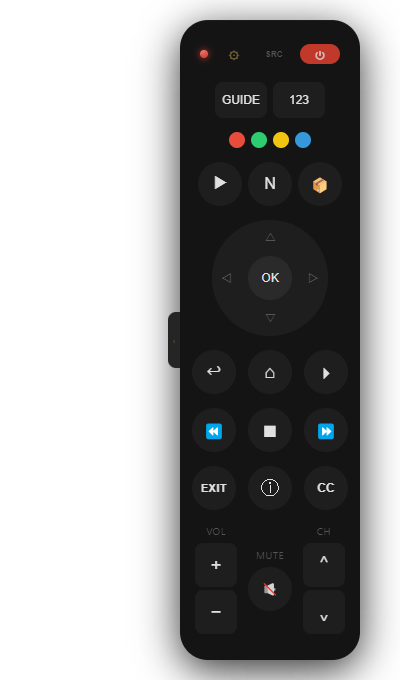
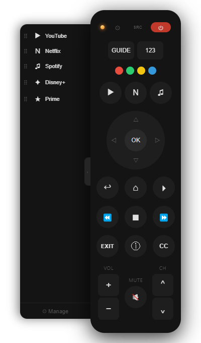

# TV Remote

<p align="center">
  
  
</p>

A Samsung smart TV remote control for Windows and iPhone, built with Electron and served as a PWA.

- **Windows app** — frameless, transparent overlay; sits in the corner of your screen. Draggable, always on top optional.
- **iPhone / browser** — a dedicated full-screen mobile UI served over HTTP from the desktop app; add it to your home screen as a PWA.

## Features

- WebSocket remote control (Samsung Tizen API, port 8002)
- Auto-discovery of Samsung TVs on the local network via SSDP (`ssdp:all`, SERVER-header filtered)
- App launcher backed by a database of 4 320 apps across 18 regions
- Region auto-detection from the TV's country code; manual override in settings
- Searchable app catalog: type to filter or browse all region apps; icons from curated catalog where available
- Pinned apps row for quick launch (first 3 apps)
- **Desktop:** slide-out app drawer with drag-to-reorder; app manager dialog with sync, reset to defaults, per-app ID override
- **Mobile:** full-screen app modal with edit mode (reorder, remove, add from catalog or full Samsung DB), reset to defaults
- YouTube deep-link: shift-click (desktop) or tap (mobile) the YouTube button to play a specific video by URL or ID
- Numpad panel (toggleable)
- **Type on TV** (Aa button): live-keys or send-whole-text entry, plus a trackpad to move/click the TV cursor
- Media-key shortcuts (play/pause, volume, mute) registered as global shortcuts
- Volume, channel, navigation, colour buttons, source, guide, captions, info, exit

## Requirements

- Windows 10/11 x64
- A Samsung Tizen TV (2016+) on the same local network
- The TV must have **Network → Expert Settings → IP Remote** (or similar) enabled
- First connection: accept the pairing prompt on the TV

## Installation

Download the latest release from the [Releases](../../releases) page:

| File | What it is |
|---|---|
| `TV Remote Setup x.x.x.exe` | NSIS installer — installs per-user, creates Start Menu + desktop shortcuts |
| `TV Remote x.x.x.exe` | Portable — runs directly, no install needed |

### First-run certificate setup

The TV uses a self-signed HTTPS certificate. The app bypasses certificate verification
automatically, but the underlying Electron session needs to trust the TV at least once.
If the status dot stays red after setting the IP:

1. Right-click the remote → **Accept TV Certificate**
2. A browser tab opens to `https://<tv-ip>:8002` — click through the cert warning
3. Close the tab; reconnect (right-click → **Reconnect**)

## iPhone / browser use

While the desktop app is running, open `http://<your-pc-ip>:3000` on any device on the
same network. The mobile UI is a dedicated full-screen interface optimised for touch.
On iPhone, use Safari → Share → **Add to Home Screen** for a full-screen PWA.

The desktop acts as a proxy for both the WebSocket connection and TV REST API calls,
so mobile browsers never need to trust the TV's self-signed certificate directly.

## Building from source

```bash
git clone https://github.com/kiforsbe/tvremote.git
cd tvremote
npm install
npm start          # run in development
npm run dist       # build installer + portable into dist/
```

### Tests

```bash
npm test               # unit tests (Jest)
npm run test:blackbox  # blackbox server tests
npm run test:e2e       # Playwright e2e (requires npm start in another terminal)
```

### Icon generation

Icons are generated from `build/source.png` via Jimp:

```bash
npm run icons
```

## How it works

### TV connection

Samsung Tizen TVs expose a WebSocket endpoint at `wss://<ip>:8002/api/v2/channels/samsung.remote.control`.
The app connects, authenticates (the TV shows a pairing prompt the first time), stores the token, and sends
JSON-encoded remote-key commands.

Mobile browsers cannot connect to the TV directly (self-signed cert, no CORS). The desktop app proxies the
WebSocket at `ws://<pc>:3000/tv` and relays app-launch REST calls at `POST /api/launch`.

### TV discovery

On opening settings, the app sends an SSDP `M-SEARCH * HTTP/1.1` with `ST: ssdp:all` and listens for
responses whose `SERVER` header contains `Samsung`. Discovered IPs are resolved to friendly names by
fetching the UPnP device description from the `LOCATION` URL.

### App launcher

`catalog.js` defines a curated set of ~50 apps with icons, regional availability, and verified app IDs.
`samsung-apps-db.json` contains the full Samsung Store database (4 320 apps, 18 regions) used for
search and discovery. The app manager lets you search, add, remove, and reorder apps; it also probes
the TV directly (`POST /api/v2/applications/<id>`) to confirm which apps are actually installed.

## Project layout

```
main.js                   Electron main process: window, IPC, HTTP server, TV proxy, discovery
preload.js                Context bridge for main window
dialog-preload.js         Context bridge for IP-settings dialog
app-manager-preload.js    Context bridge for app manager dialog
ip-dialog.html            TV IP / discovery dialog
text-dialog.html          "Type on TV" window: live keys, text entry, trackpad
text-dialog-preload.js    Context bridge for the Type on TV window
app/
  index.html              Desktop remote UI (also served as PWA fallback)
  remote.js               Desktop remote UI logic
  mobile.html             Mobile / iPhone remote UI (served at http://<pc>:3000/)
  mobile.js               Mobile UI logic
  app-manager.html        App manager dialog (desktop)
  catalog.js              Curated app catalog (~50 apps with icons and region data)
samsung-apps-db.json      Full Samsung app database (4 320 apps, 18 regions)
scripts/
  generate-icons.js       Icon generation from source PNG
  release.js              Version bump + changelog roll + tag (npm run release)
  test-discovery.js       SSDP discovery probe (development utility)
tests/
  unit/                   Jest unit tests
  blackbox/               Blackbox HTTP server tests
  e2e/                    Playwright layout tests
```

## Development

See [DEVELOPMENT.md](DEVELOPMENT.md) for running, testing, releases and packaging, and
[CHANGELOG.md](CHANGELOG.md) for what changed in each version.

## License

MIT — see [LICENSE](LICENSE).
